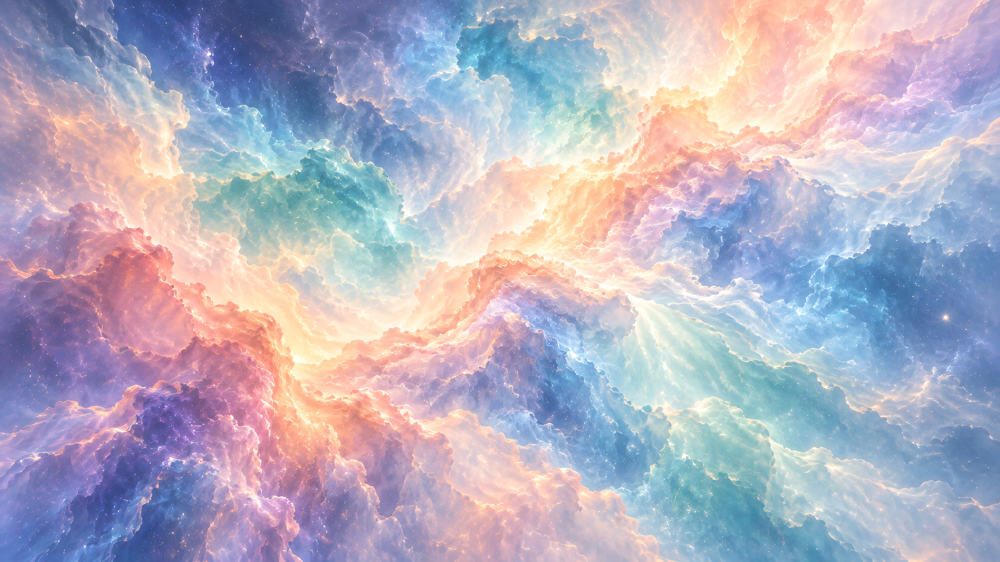
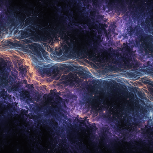
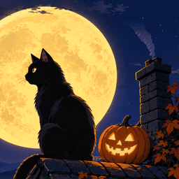
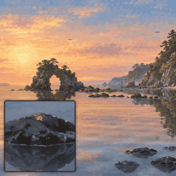
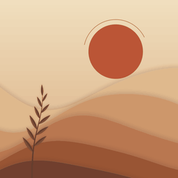
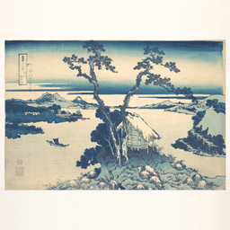
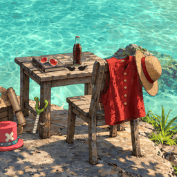
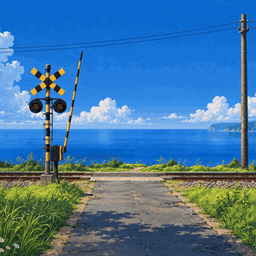

# Wallpaper Lab

Animated web wallpapers for [Wallpaper Engine](https://www.wallpaperengine.io/). Each one starts from AI-generated or public-domain art, which is then cut into layers and brought to life with hand-written WebGL / Canvas code. The repo also holds the tools and write-ups of the techniques behind them. It is a non-commercial hobby project, and some pieces are fan art.

## Wallpapers

| | Wallpaper | What it is |
|---|---|---|
|  | [Opaline](wallpapers/published/opaline/) | Pastel space nebula with slow flowing filaments (WebGL shader over painted art). On the [Steam Workshop](https://steamcommunity.com/sharedfiles/filedetails/?id=3827277599) · [video](https://youtu.be/CjZC_7ZGiQk). |
|  | [Luminous Streams](wallpapers/published/luminous-streams/) | Violet nebula split by a river of gold and cyan lightning, with moving cloud banks, fog and dust. On the [Steam Workshop](https://steamcommunity.com/sharedfiles/filedetails/?id=3827937921) · [video](https://youtu.be/pFgJkYvbZco). |
|  | [Moon Cat](wallpapers/published/moon-cat/) | Halloween 2026: a cel-anime black cat on a rooftop under a huge moon. It looks at you now and then while a sheet ghost, a witch, lantern ghosts, wisps and bats come by. On the [Steam Workshop](https://steamcommunity.com/sharedfiles/filedetails/?id=3829769876) · [video](https://youtu.be/4pXhe8PB6ag). |
|  | [Golden Shallows](wallpapers/published/golden-shallows/) | Painted golden-hour cove: a rock arch in calm mirror water, pines bending in the sea breeze, a little crab on the rocks. On the [Steam Workshop](https://steamcommunity.com/sharedfiles/filedetails/?id=3832664548). |
|  | [Sunroom](wallpapers/published/sunroom/) | Paper dunes under a sun and moon, drawn entirely by code: set any time of day or follow your PC's clock. On the [Steam Workshop](https://steamcommunity.com/sharedfiles/filedetails/?id=3833207645) · [video](https://youtu.be/-LcWhYW59Ko). |
|  | [Living Print — Lake Suwa](wallpapers/published/living-print/) | Hokusai's *Lake Suwa* brought to life: water, wind, boats and wildlife, with the print set on a colour of your choice. On the [Steam Workshop](https://steamcommunity.com/sharedfiles/filedetails/?id=3834391346) · [video](https://youtu.be/M3nPVh6UuDc). |
|  | [Straw Hat Cove](wallpapers/published/straw-hat-cove/) | One Piece fan-art cove: layered lagoon water, swaying plants, small live details. On the [Steam Workshop](https://steamcommunity.com/sharedfiles/filedetails/?id=3835374514) · [video](https://youtu.be/HFNUrLrGlnk). |
|  | [Summer Crossing](wallpapers/published/summer-crossing/) | Sunny anime afternoon at a little seaside railway crossing: clouds and sea moving, plants in the wind, and now and then a train comes through. On the [Steam Workshop](https://steamcommunity.com/sharedfiles/filedetails/?id=3836189135) · [video](https://youtu.be/TXCtqxtrrsE). |

Each wallpaper folder has a README (what it does, settings, credits) and `package/`, which is exactly what Wallpaper Engine loads. To try one in a browser, serve the repo root, for example with `python -m http.server`, and open `wallpapers/published/<name>/package/index.html`.

## What else is here

- [docs/approaches/](docs/approaches/README.md): techniques for animating a painting as a wallpaper (water, plants, cut-outs, clean plates, sky mattes, preview GIFs, keeping a WebGL wallpaper small), including what didn't work.
- [docs/tools/](docs/tools/README.md): the tools behind them, with commands and pitfalls: segmenters, upscalers, image generation, image-to-3D, Blender, headless checks, a web-wallpaper starter kit and a gallery page.
- [tools/](tools/README.md): `wl`, a small command-line tool to start, check, record and package a Wallpaper Engine web wallpaper.
- [wallpapers/ideas/](wallpapers/ideas/README.md): shelved builds and notes on ideas that weren't made.

## Licence

Code and docs are MIT. The art and the wallpapers themselves are all rights reserved: use them through Wallpaper Engine, but please don't re-upload them. See [LICENSE](LICENSE).

## Credits

- **Art:** generated with OpenAI image models via Codex unless noted, then cut, layered and animated by hand-written code.
- **Living Print:** based on Katsushika Hokusai, *Lake Suwa in Shinano Province*, The Metropolitan Museum of Art, Open Access (public domain).
- **Offline tools:** OpenCV, Finegrain Box Segmenter, SAM 2.1, 4x-UltraSharp, 4x_foolhardy_Remacri, Practical-RIFE, TripoSR and Blender were used offline for cut-outs, upscaling, in-betweens and 3D. No model or tool ships with the wallpapers. Download links are in [docs/tools/](docs/tools/README.md).
- **Fan art:** Straw Hat Cove is unofficial, non-commercial fan art. One Piece and its characters are © Eiichiro Oda / Shueisha / Toei Animation. It is not affiliated with or endorsed by them.
- Each wallpaper's README lists its own specifics.
