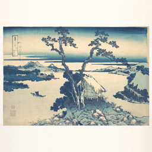

# Living Print

Hokusai's *Lake Suwa in Shinano Province* as a quiet living print. The whole museum scan stays in view on its own white paper, while the pines, plants, boat, water, sky and a few small creatures move.



On the [Steam Workshop](https://steamcommunity.com/sharedfiles/filedetails/?id=3834391346) (item 3834391346, 2026-11-05) · [video](https://youtu.be/M3nPVh6UuDc).

## Controls

All sliders run 0-100. 50 is the tuned look and 0 turns that part off.

| Control | Key | What it moves |
| --- | --- | --- |
| Background | `backgroundcolor` | A colour picker for everything around the sheet. The default is the scan's own white. |
| Speed | `motionspeed` | The whole scene. 0 stops it and stops drawing. |
| Wind | `windstrength` | Pines, reeds and bushes. |
| Water | `watermovement` | Lake strokes, boat, sail and hull ripples. |
| Sky | `skymovement` | Pigment drift and wash bands. |
| Wildlife | `wildlife` | Crane, dragonfly and fish. Below 25 no crane, from 75 two cranes. |
| Render scale | `renderscale` | Internal resolution: 50%, native, 150%. |

## How it was built

Original print pixels were separated into layers with polygons, ink thresholds and donor fills. Masked shaders move the water and sky, a mesh bends the attached sail, and the wildlife is flat ink. Mountains, buildings and paper edges stay fixed.

A finish pass on 2026-11-02 changed the art as follows:

1. Seam fixing restores the plate to the print wherever a cut-out barely moves, refills the sky behind the crowns with real grain, and un-mixes the moving edges. With every motion slider at 0 the frame now matches the print except for scattered pixels.
2. The two taped labels are painted the two taped labels out of the white border.
3. The border's own tones are carried the border's own tones outward to fill the screen, so the border has no visible edge at any aspect ratio.
4. The sheet is cut the sheet out of the scan's white and un-mixes its edge, so the Background colour reaches the paper with no white fringe. At the default colour the picture stays the same, apart from a faint grey line beside the sheet that is now gone.
5. Small mipmapped crane textures are made, which keep the ink lines clean at the size the crane is drawn.
6. Colour is cleared stored under transparent tree pixels. The package went from 17.8 MB to about 6 MB with the same picture.

## Run it

Wallpaper Engine: subscribe on the Workshop, or open `package/project.json` in the editor.

Browser: serve the repository root and open `package/index.html`. Plain Chrome blocks file-origin WebGL images, so open it through a local server or start Chrome with `--allow-file-access-from-files`.

Checks, from the repository root:

```bash
node docs/tools/web-wallpaper-kit/verify.cjs wallpapers/published/living-print/package
```

## Credits

- Katsushika Hokusai, *Lake Suwa in Shinano Province*, ca. 1830-32. Source: The Metropolitan Museum of Art, Open Access (public domain), object 56240. [Museum record](https://www.metmuseum.org/art/collection/search/56240).
- The painted crane was generated for this project with OpenAI image models through Codex and is not part of the print. The dragonfly and fish are drawn in code. No upscaler or segmentation model was used.
- AI-art note: the print itself is a museum scan; the crane is the only AI-generated image. Personal, non-commercial project.

## Known flaws

- The art is 1948x1347. With the whole print on screen it shows at 79% at 1080p, 105% at 1440p and 158% at 4K, so it is a little soft at 4K. It was not upscaled: every layer is a full-size texture, so 2x would take GPU memory to about 680 MB against the 256 MB target, and the files well past 15 MB.
- Strong wind can show approximate fills behind the crowns.
- A faint dark foxing speck is repeated in the sky behind the crowns. It is barely visible at t=3.3 s, when the gust is strongest.
