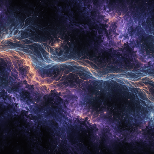

# Luminous Streams

A painted violet/cyan nebula with local cloud movement, branch lightning, coloured fog and drifting dust. Published 2026-10-26 as release 1.5: [Steam Workshop item 3827937921](https://steamcommunity.com/sharedfiles/filedetails/?id=3827937921) · [YouTube video](https://youtu.be/pFgJkYvbZco). Defaults are the tuned 1.3 settings plus a baked colour boost; the painting is upscaled with Remacri (lightning softened 50%).

## Controls

Six integer Wallpaper Engine sliders, all 0-100 with default 50. Each maps linearly on either side of 50; values below are internal renderer values, not slider percentages. 50 equals the values 1.3 ran with (cloud amount 100%, speed 97%, lightning 84%, fog 42%, dust 40%).

| Property | At 0 | At 50 (selected look) | At 100 |
|---|---|---|---|
| `cloudamount` | Clouds off | Edge 1, drift 1.053 | Edge 1.5, drift 1.579 |
| `cloudspeed` | Clouds still | .97 | 2 |
| `lightninglevel` | Discharges off | 3.36 | 6 |
| `dustamount` | Dust off | .4 | 1 |
| `fogamount` | Fog off | .42 | 1 |
| `renderscale` | 50% resolution | Native resolution | 150% resolution |

Colour: the final image gets a fixed 1.3x saturation boost, the same maths as CSS `saturate()` that Wallpaper Engine's own Saturation option applies (WE saturation 60-70 looked better than 50 in testing). It is not a slider, since WE already has one. Cloud speed changes preserve phase and affect only clouds; lightning, dust and fog continue. Render scale cannot be off. Higher settings and supersampling are unprofiled. Old `*_percent` keys are ignored so saved values are not misread on the new scale.

## How it was built

The generated painting (1672x941) and its two hidden backing plates are shipped upscaled to 2560x1441 with 4x Remacri. On the lightning threads the painting is blended 50% back toward the softer original, because the original's soft lightning looked better while Remacri looked better everywhere else ("Soft 50", picked 2026-10-26 from full-frame comparisons and a live test in WE). Masks and data layers stay at 1672x941, and the shader measures its effects on that grid (`ART_W`/`ART_H`), so the larger painting changes sharpness only. WebGL animates local bank edges against hidden backing plates, using hand-painted coverage (upper stroke feathered in 1.2). Drifting Dust at internal .4 was selected in 1.3. Coloured electricity spill stays disabled.

`wallpaper.js` holds the shaders and renderer. Eight of the eleven layers in `assets/` are the exact bytes of the selected 1.3 source; the other three are the upscaled painting and plates. The runtime has no tuning panel, selectors or keyboard shortcuts.

## Run it

Subscribe on the [Workshop](https://steamcommunity.com/sharedfiles/filedetails/?id=3827937921), or open `package/project.json` in the Wallpaper Engine editor.

For browser use, serve the repository root and open `wallpapers/published/luminous-streams/package/index.html`. Plain Chrome blocks local-file WebGL textures, so use a local server.

## Credits

Nebula art and hidden backing plates: OpenAI image generation through Codex, upscaled with 4x_foolhardy_Remacri (Foolhardy, CC BY-NC-SA 4.0). Coverage painting: by hand. Shaders and runtime: project code. No third-party runtime libraries or remote assets. Personal, non-commercial project.

Made with AI image generation: the painting was generated with OpenAI image models through Codex, then edited and animated by hand and in code.

## Known flaws

- Painting and plates are 2560 px wide, so 1440p is about 1:1; ultrawide still stretches them. Masks are still 1672x941; approximate masks and backing plates can show under close inspection. Large unmarked cloud silhouettes remain fixed.
- Browser lifecycle checks deliver 9.994 / 30.317 / 9.992 FPS at limits 10/30/10 in a small GPU viewport. Pause cancels RAF; hidden/host reasons overlap correctly. Automatic fullscreen/game pause and native context restoration are unverified.
- Canvas resolution uses CSS viewport pixels times render scale, including on DPR2.
- `assets/light.png` (727 KB) is loaded but never shows, because coloured spill is off. Removing it needs a re-publish.

## Browser cost / 2026-10-20

GTX 1070 Ti, native resolution/DPR 1, sliders 50: draw plus synchronous readback medians 7.65/13.05/42.50 ms at 1080p/1440p/ultrawide (12 samples each). Separate cap 30 playback 30.32/29.99/29.99 FPS. Ultrawide readback varies widely (17.10-66.30 ms). Short browser probes include synchronization overhead and do not establish pure GPU cost or sustained Wallpaper Engine performance. Measured before the art upscale; the upscale itself changed 1440p cost from 20.2 to 20.4 ms.
