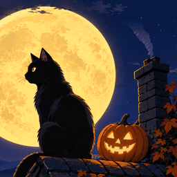

# Moon Cat

A black cat sits on a rooftop under a huge full moon on Halloween night. Now and then it turns to look at you with a slow blink, sniffs, licks or flicks an ear, and its tail sways and curls. A little sheet ghost plays hide and seek with the chimney, a witch and her cat fly across the moon, small ghosts carry lanterns up to the castle and will-o'-wisps rise from the lake. Bats flit past, the jack-o'-lantern glows, chimney smoke drifts, the town's windows switch on and off, and ivy leaves fall and grow back.

Published 2026-10-29: [Steam Workshop](https://steamcommunity.com/sharedfiles/filedetails/?id=3829769876) (item 3829769876, "Moon Cat - Cute Halloween Night"), [YouTube](https://youtu.be/4pXhe8PB6ag) ("Moon Cat - Wallpaper").

## Controls

Four 0-100 sliders; 50 is the tuned look. Moving one carries on from where things are (nothing jumps).

- **Ghosts & witch**: how often the ghosts, the witch and the bats come by. 0 = never, 50 = about every half minute, 100 = one after another, no breaks.
- **Leaves**: how often ivy leaves fall. 25 or less = none, 0 = the ivy holds still too.
- **Clouds**: how fast the clouds drift. 0 = still.
- **Lights**: the town's windows and the jack-o'-lantern. 0 = dark.

## How it was built

From one cel-anime painting (style A). The painting was taken apart one element per Codex edit, so every moving part has a clean painted plate behind it. It was upscaled 2x and cut into layers. The cat is animated the way cel animation does it, never by warping one drawing: its head moves between complete drawn poses, with smooth 30 fps in-betweens made by frame interpolation (RIFE). Its tail bends along a small physics simulation. The chimney ghost is a Blender cloth simulation rendered toon-flat, the witch one drawing with simulated hair, skirt and broom. A small WebGL layer engine draws it all: about 1.6-2.1 ms per frame at 1080p and 1.9 ms at 4K in headless Chrome on a GTX 1070 Ti (an upper bound).

## Run it

Subscribe on the Workshop, or open `package/project.json` in the Wallpaper Engine editor. In a browser, serve the repo root and open `wallpapers/published/moon-cat/package/index.html`.

## Credits

Art generated with OpenAI image models via Codex, upscaled with 4x-UltraSharp (Kim2091, CC BY-NC-SA 4.0), cut-outs with Finegrain Box Segmenter, in-betweens with Practical-RIFE 4.25 (hzwer, MIT), chimney ghost simulated in Blender. Code hand-written. Personal, non-commercial project.

Made with AI image generation: the painting was generated with OpenAI image models through Codex, then edited and animated by hand and in code.

## Known flaws

- A 1-2 px cyan speck at the very tip of the pumpkin stem.
- 32:9 shows no town or lake; portrait crops the pumpkin.
- About 225 MB of GPU memory: fine on a gaming GPU, maybe heavy on weak integrated graphics (no quality slider, by design).
