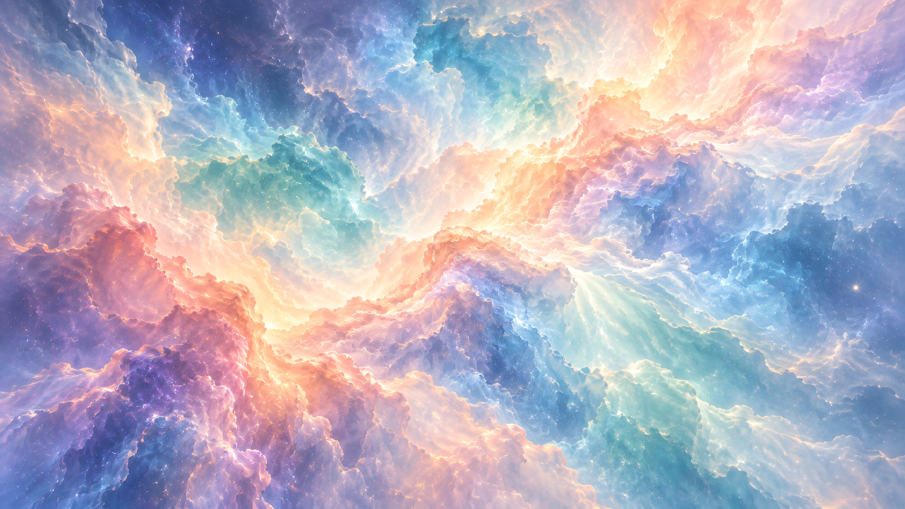

# Opaline

A peach, periwinkle and seafoam nebula with slowly moving cloud currents, as a Wallpaper Engine web wallpaper. Version 1.2, published 2026-10-25: [Steam Workshop](https://steamcommunity.com/sharedfiles/filedetails/?id=3827277599) · [video](https://youtu.be/CjZC_7ZGiQk). 

## Controls

All sliders are 0-100. 50 is the look tuned in 1.0.1; Motion speed defaults to 30 (slower), chosen for 1.1.

| Wallpaper Engine property | Default | What it does |
| --- | --- | --- |
| Motion speed (`motionspeed`) | 30 | Animation time scale (50 = the 1.0.1 speed). 0 freezes the effect and stops drawing; 100 is twice the 1.0.1 speed. |
| Cloud movement (`cloudmovement`) | 50 | Strength of the cloud displacement, light and dust. 0 also freezes; 100 is double. |
| Render scale (`renderscale`) | 100 | Internal resolution in percent of each dimension, 35-100. Lower costs less GPU time. |

For brightness, contrast, saturation and hue, use Wallpaper Engine's own colour options. The frame rate follows Wallpaper Engine's global FPS setting; the wallpaper has no FPS control of its own. There is no on-screen panel or keyboard shortcut in the wallpaper itself.

## How it was built

- One WebGL pass samples a single painted nebula through layered, evolving noise displacement, with soft illumination and sparse dust. It is image-based shader animation, not a cloud simulation. The camera is fixed and the motion has no loop reset.
- The painting is a 2200x1238 master: the 1672x941 generated original upscaled with 4x-UltraSharp and scaled down to about 1:1 for a 1920x1080 screen. That one file, `nebula.jpg` (0.8 MB), is the texture, the Wallpaper Engine preview and the fallback still. The animation fades in once its first frame is drawn.
- Time stepping is independent of frame rate. Displacement fades near the art's edges, so maximum movement leaves no clamped streaks.
- Layout is a cover fit (cropped, never stretched); the pixel count is capped at 3840x2160.
- 1.1 changes: 0-100 sliders, the tuning panel moved out of the wallpaper into a separate preview page, the sharper master, a fade-in on start, and the package shrank from 5.5 MB to 0.8 MB. With every slider at 50 the 1.0.1 shader output is pixel-identical (checked on the old art).
- 1.2 (Workshop release): slider labels are just the names, the Brightness slider was dropped (Wallpaper Engine's own colour options cover it), and a square `preview.gif` was added for the Workshop.

## Run it

- Wallpaper Engine: Create Wallpaper, then open the `package/` folder's `project.json` (or copy the folder into `projects/myprojects`). Keep `project.json`; importing only `index.html` regenerates the metadata and loses the custom controls.
- Browser: serve the repo root (`python -m http.server 8861`) and open `wallpapers/published/opaline/package/index.html`. Opening `index.html` directly also works and shows the wallpaper with default settings.

## Credits and licences

- Artwork: generated with the image-generation tool built into Codex (OpenAI), prompted for a soft peach, periwinkle and seafoam nebula. Upscaled offline with 4x-UltraSharp (Kim2091, CC BY-NC-SA 4.0); no model ships with the wallpaper.
- Inspiration: the moving-nebula Workshop item 星云变换t001 (Steam Workshop id 833227004), which was the starting point for the look.
- No third-party code or libraries. The WebGL shader and scheduler are original.
- Personal, non-commercial project, free on the Steam Workshop (item 3827277599).
- AI-art note: the only artwork is one AI-generated painting; the motion is original shader code.

## Known flaws

- The master is sized for 1920x1080. On 1440p and ultrawide screens the GPU still scales it up about 1.3-1.8x.
- Tested on a GTX 1070 Ti only.
