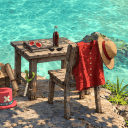

# Straw Hat Cove

The Straw Hats' belongings on a rock ledge above a clear cove, as a Wallpaper Engine web wallpaper. Light ripples over the seabed, the plants and clothes move in the sea breeze, clouds drift past, and the small things are alive too: a wisp from Sanji's cigarette, fizz in Franky's cola, shine on the glasses and the Log Pose, frost creeping from Brook's cane.

Version 1.2, on the [Steam Workshop](https://steamcommunity.com/sharedfiles/filedetails/?id=3835374514) since 2026-11-07 · [video](https://youtu.be/HFNUrLrGlnk).

## Controls

Thirteen 0-100 sliders; 50 is the tuned look.

| Slider | 0 | 100 |
|---|---|---|
| Distant waves | flat sea | double |
| Sun glints | off | double |
| Extra caustics | off (50 = a faint web of light) | strong web |
| Extra caustics speed | still | twice as fast |
| Wind on props | still | stronger sway |
| Plant sway | still | double |
| Cigarette smoke | off | five times the smoke |
| Cola fizz | off | double |
| Glass shine | off | double |
| Frost & cold vapour | off | double |
| Cloud speed | still | about 8 times as fast |
| Ultrawide framing | more sky | more ledge |
| Render scale | 40% | 150% |

Ultrawide framing only does something on screens wider than 16:9. The frame rate follows Wallpaper Engine's FPS setting, and brightness and colour are in its own options.

There is no panel or shortcut in the wallpaper.

## How it was built

Source art is one generated painting with props added one Codex image edit at a time, so each prop has an exact clean plate behind it. It was upscaled 2x with 4x-UltraSharp, and the swords, guards, sheaths, cigarette and vest buttons were repainted because the sharper art made them look garbled. Plants, cloth and props are cut-outs moved separately. One WebGL2 fragment shader plus a small foliage pass draws everything.

## Run it

- Wallpaper Engine: open `package/project.json` in the editor. Importing only `index.html` loses the sliders.
- Browser: from the repo root run `python -m http.server 8861`, then open `http://127.0.0.1:8861/wallpapers/published/straw-hat-cove/package/index.html`.

## Credits and licences

- Art generated with OpenAI image models through Codex, from reference images and prompts. AI-art note: the painting and every prop were generated this way and then cut out and animated by hand and in code.
- Upscaled with 4x-UltraSharp (Kim2091, CC BY-NC-SA 4.0). Cut-outs made offline with Finegrain Box Segmenter and SAM 2.1 Tiny. No model runs inside the wallpaper.
- Code hand-written. The wallpaper makes no network requests.
- The cell-border (Voronoi edge distance) function in `package/scene.js`, used by the optional crisp caustics, follows [Inigo Quilez](https://iquilezles.org/articles/voronoilines/).
- Unofficial, non-commercial fan art. One Piece and its characters © Eiichiro Oda / Shueisha / Toei Animation. Not affiliated with or endorsed by them.

## Known flaws

- About 215 MB of GPU memory at 1080p and 254 MB at 1440p. Fine on a gaming GPU, maybe heavy on weak integrated graphics; Render scale lowers only part of it.
- At 21:9 the default framing crops the sky to keep Chopper's hat in view. Ultrawide framing at 0 shows more sky. At 4:3 the sides are cropped, and every prop stays in frame.
- The bandana tail can show a slightly jagged painted edge on the white saya when it swings.
- Small static strips of shallow water remain beside the beach rocks, under the right-hand rocks and along the ledge edge.
- Plants can show a faint doubled edge in strong gusts. A few pixels of chair plank edge can show at the strongest vest swing.
- Clouds slide rigidly and don't change shape. The second layer is a mirrored, smaller copy of the first.
- Cola bubbles are 1-2 px at source scale, so they read mostly as glints.
- Moving starts after about 1.2-1.5 s, with the painted first frame shown until then. Wallpaper Engine keeps no compiled shaders, so this happens at every start.
