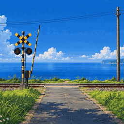

# Summer Crossing

A sunny anime afternoon at a small railway crossing above the sea. Clouds drift with their shadows over the land and water, the sea rolls in, the lawns and the far trees move in the wind, and every few minutes the lamps blink, the gate comes down and a train comes through: a painted express at speed, or a two-car local with turning wheels. Now and then a plane draws a short contrail.



On the [Steam Workshop](https://steamcommunity.com/sharedfiles/filedetails/?id=3836189135) (item 3836189135, published 2026-11-08) · [video](https://youtu.be/TXCtqxtrrsE).

## Controls

Sliders run 0-100. 50 is the tuned look, 0 stops that part. Rumble is off by default.

| Control | Key | What it does |
| --- | --- | --- |
| Clouds | `clouds` | Cloud drift, their shadows on the land and their reflections in the sea. 0 holds them still (and no plane comes). |
| Sea | `sea` | How fast the water moves. 0 stands it still; the reflections keep following the clouds. |
| Plants wind | `wind` | The lawns, flowers and weeds. |
| Trees wind | `treewind` | The trees and bushes along the far verge. |
| Express often | `express` | 0 never, 50 about every 2.8 minutes, 100 about every minute. |
| Local often | `local` | The same for the local. |
| Train speed | `trainspeed` | Both trains: 0 a quarter, 50 the tuned speeds, 100 four times. |
| Rumble | `rumble` | The picture rocks a little while the express passes. Default 0. |
| Contrail | `contrail` | A plane every 2.5-4 minutes. |
| Gate arm | `gate` | The gate arm on the box, down for each train. Off leaves the box bare. |

With every slider at 0 the wallpaper stops drawing. It follows Wallpaper Engine's FPS setting and pause. The leaf shadows on the road always move.

## How it was built

The painting is a Codex image (concept B of several), upscaled with 4x-UltraSharp to a 2x master (3344 px wide). Every moving part sits on a clean plate made for it, so nothing moves the ground under it:

- **Sky**: a cloudless Codex plate, the clouds un-mixed from it and continued by Codex into a 2544 px strip that wraps; mattes for the pole, wires, signal and headland from Codex magenta keys; the wires redrawn live so they can sag and ring; high wisps and the contrail in the shader.
- **Sea**: a calm plate tone-matched to the painting, fine marks on rigid sheets sliding one way with the wind, cloud reflections as columns that follow the real clouds, gust patches, the headland's mirror and surf, and faint wave crests rolling in.
- **Plants**: Codex meadow grounds with the plants removed, whole Codex plants on magenta drawn on top and bent from their roots; the far trees as leaf clumps swaying like Straw Hat Cove's foliage, the far weeds whole to their roots; every daisy head redrawn by Codex in its painted pose and coloured from the painting.
- **Road**: a painted Codex road plate, and only a texture-free leaf-shadow shape moving over it.
- **Trains**: the express and local repainted by Codex, with motion blur over one frame's travel; the local's wheels carry Codex rust marks that turn at the rolling speed; the signal stays in front through its matte.
- **Crossing**: the painted gate arm, its mount and lit lamp lenses.

## Run it

Wallpaper Engine: subscribe on the [Workshop](https://steamcommunity.com/sharedfiles/filedetails/?id=3836189135), or open `package/project.json` in the editor.

Browser: serve the repository root and open `wallpapers/published/summer-crossing/package/index.html`. Plain Chrome blocks file-origin WebGL images, so use a local server or start Chrome with `--allow-file-access-from-files`.

Checks, from the repository root:

```bash
node docs/tools/web-wallpaper-kit/verify.cjs wallpapers/published/summer-crossing/package
```

## Credits

- Art: generated with OpenAI image models through the Codex CLI image tool and edited step by step. AI-art note: the painting, plates and plants are AI-generated; the motion and the shaders are original code.
- Upscaling: 4x-UltraSharp (Kim2091, CC BY-NC-SA 4.0). No model ships with the wallpaper.
- Personal, non-commercial project.

## Known flaws

- A cloud shadow crossing a train darkens it in whole columns, the shadow of the ground at its foot.
- Sea reflection pillars stay where they are painted while the clouds drift over 12 minutes, so a pillar can sit under open sky.
- The express at Train speed 0 is drawn from a sharper paint that loads the first time it's needed, so the first slow express after a change can show the blurred paint for a frame.
