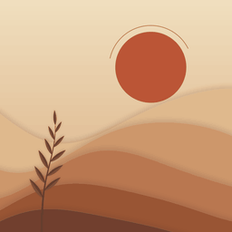

# Sunroom

Paper dunes under a sun and moon, drawn entirely by code, as a Wallpaper Engine web wallpaper. Set any time of day or let it follow your PC's clock. On the [Steam Workshop](https://steamcommunity.com/sharedfiles/filedetails/?id=3833207645) · [video](https://youtu.be/-LcWhYW59Ko).

## Controls

| Control | Default | What it does |
| --- | --- | --- |
| Follow PC clock | Off | The time of day follows your PC: night until 5:00, day from 9:00 to 17:00, noon from 12:00 to 13:00, sunset around 19:00. |
| Time of day | 50 | 0 night, 25 dusk, 50 sunset, 75 day, 100 noon. Hidden while the clock is on. |
| Plant | Branch | Branch, Dune grass, Pampas or None. |
| Plant size | 50 | 0 = no plant. |
| Wind | 50 | How much the plant moves. 0 = still. |
| Tempo | 50 | How fast everything moves. 0 = still, and it stops drawing. |
| Rise and fall | 50 | How much the dunes go up and down. |
| Roll sideways | 50 | How fast the dunes slide along. |
| Curve height | 50 | How tall the curves are. |
| Number of curves | 50 | How many curves fit on screen. |
| Sun size | 50 | Size of the sun and moon. |
| Sun height | 50 | How high they sit. |
| Sand lines | 50 | The fine lines on the front dunes. 0 = off. |
| Dust | 50 | The specks in the air. 0 = off. |

Brightness, contrast and colour are in Wallpaper Engine's own colour options. The frame rate follows its FPS setting.

## How it was built

Everything is drawn in one WebGL canvas with no image files. The dunes are worked out per column in the vertex shader, the stars and dust are single points, and the plants are ribbons with soft edges and a small blurred shadow. Five colour palettes, from night to noon, blend into each other.

It started as a 25-line Canvas 2D sketch from a batch of ten scenes on 2026-10-08. For this release it was rewritten for the new controls, day and night, and a better plant. A frame now takes about 0.56 ms of graphics card time at 1080p, against about 1.0 ms before the speed work, and that older figure didn't even include its plant.

## Run it

- **Wallpaper Engine:** subscribe on the Workshop, or Create Wallpaper and open `package/project.json`.
- **Browser:** serve the repo root with `python -m http.server` and open `wallpapers/published/sunroom/package/index.html`.

## Credits and licences

Original code made for Wallpaper Lab, with no third-party code or art in the wallpaper. A concept board made with an image generator was the starting point for that batch, but none of it ships. AI-art note: there is no AI-generated art in the wallpaper itself. Personal, non-commercial project.

## Known flaws

- The automatic pause for fullscreen games and apps hasn't been tested on this build.
- With Follow PC clock on, the look updates once a minute rather than continuously.
- The preview GIF moves more than the wallpaper does at default, keeps the sun and moon at one size and height, and leaves out the grain, dust and sand lines.
